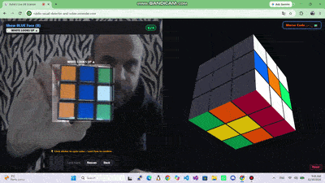
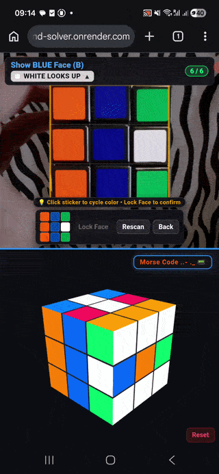
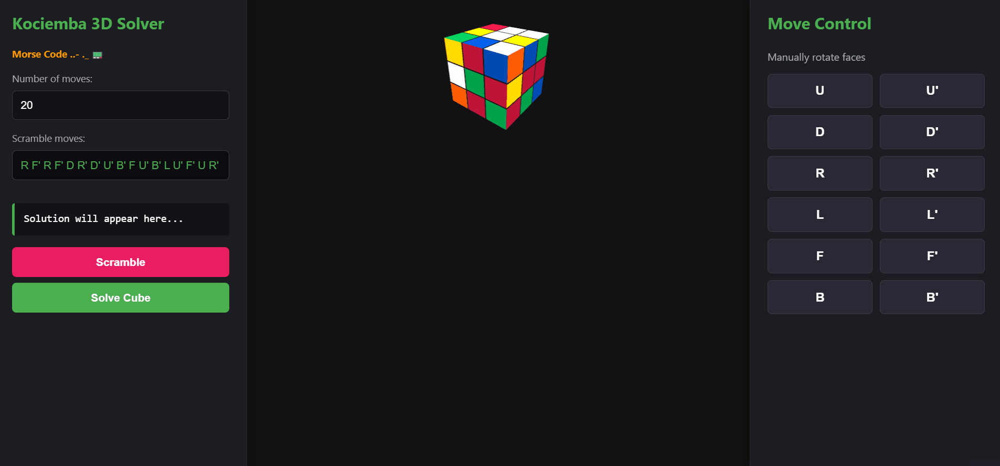
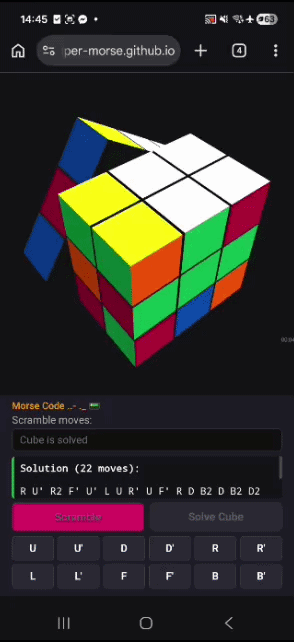
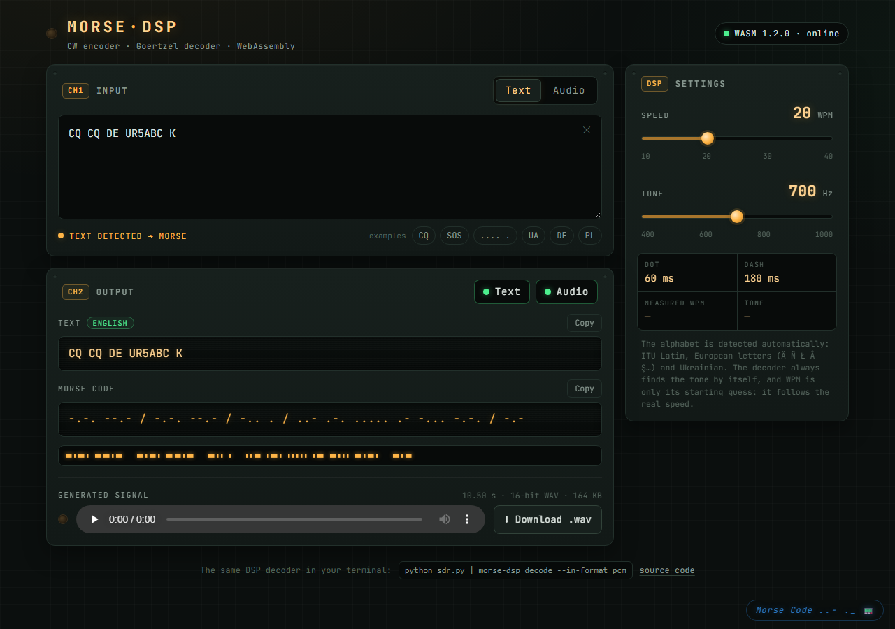
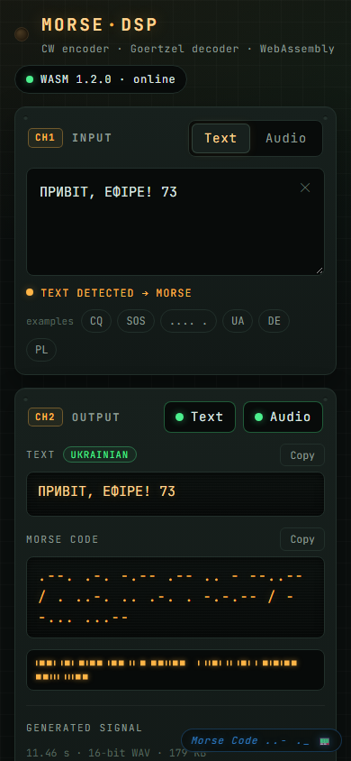
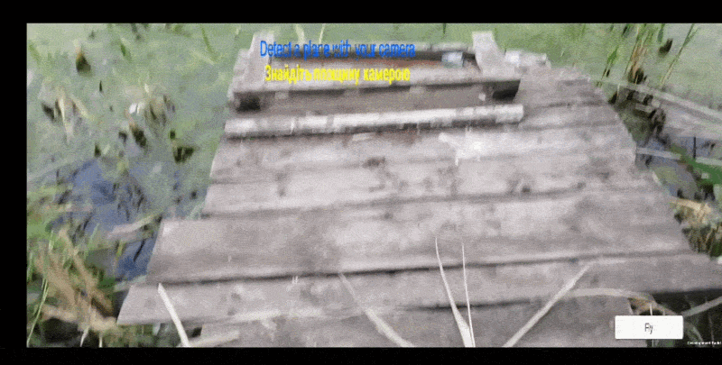

# Hi, I'm Morse 👋

## Python / Go Developer

I am an experienced **Python** developer specializing in computer vision, machine learning, and smart data processing, combined with building high-performance backend systems in **Go**. I enjoy designing end-to-end architectures where intelligent Python-driven analysis seamlessly integrates with blazing-fast Go infrastructure.

---

## 💻 Key Projects in Focus

### 📸 1. Rubik's Cube CV Detector (Python + Computer Vision)
An intelligent detector designed to recognize the state of a scrambled physical Rubik's Cube from a photo/camera stream and feed its color matrix configuration directly into a high-performance solver engine.

🚀 **Live Web App:** https://rubiks-visual-detector-and-solver.onrender.com
* **Stack:** Python, FastAPI, YOLO11 / ONNX Runtime, OpenCV, NumPy, Go (WASM), Three.js.
* **Architecture:** Python handles the vision side: a custom-trained YOLO11 model on ONNX Runtime detects stickers, validates the cube, and builds a 54-char Kociemba facelet string, which is solved client-side by the Go WebAssembly engine.
* **Code Quality:** 100% statement coverage via unit testing, 0% duplication, absolute Grade "A" for security and maintainability via SonarCloud.

👀 Demo & Interface

<b>Click to expand live animations</b>

 

  <table border="0" cellspacing="10" cellpadding="0">
    <tr>
      <td align="center" valign="top" width="60%">
        <b>🖥️ Desktop Live Scanner & Solver</b>  
        
      </td>
      <td align="center" valign="top" width="35%">
        <b>📱 Mobile View (50/50 Split)</b>  
        
      </td>
    </tr>
  </table>

---

### 🧩 2. Rubik's Cube 3D Solver (Go + WebAssembly)
An ultra-fast, interactive 3D Rubik's Cube application featuring a high-performance solver built with pure Go and compiled to WebAssembly to run natively in the browser.

* **🔗 Live Demo:** [super-morse.github.io/rubiks-solver](https://super-morse.github.io/rubiks-solver/)
* **Stack:** Go (Golang), WASM, JavaScript (ES6+), Three.js (WebGL).
* **Code Quality:** 100% statement coverage via unit testing, 0% duplication, absolute Grade "A" for security and maintainability via SonarCloud.

👀 Demo & Interface

<b>Click to expand live animations</b>

 

  <table border="0">
    <tr>
      <td align="center" valign="top" width="60%">
        <b>🖥️ Desktop Full-Width View</b>  
        
      </td>
      <td align="center" valign="top" width="35%">
        <b>📱 Mobile View (Samsung A16)</b>  
        
      </td>
    </tr>
  </table>

> 💡 **Architectural Trade-off:** The Two-Phase Kociemba solver routine executes directly in the browser in just **~40ms**. Heavy algorithmic workloads are offloaded from the server straight to the client-side binary runtime via WASM, ensuring absolute zero UI lag.

---

### 📟 3. Morse DSP — CW Encoder & Streaming Decoder (Go + DSP + WebAssembly)
A real-time **Morse code (CW)** toolkit written in pure Go: a text codec, a click-free CW audio synthesizer and a streaming **DSP decoder** built on the **Goertzel algorithm**. It ships as a Unix-pipe-friendly CLI and as a WebAssembly radio console that runs entirely in the browser. The alphabet (ITU Latin, major European alphabets and Ukrainian) and the CW tone are detected automatically, with no settings needed.

* **🔗 Live Demo:** [super-morse.github.io/morse-dsp](https://super-morse.github.io/morse-dsp/)
* **📘 Study Guide (Ukrainian):** [morse-dsp зсередини](https://super-morse.github.io/morse-dsp/learn.html), the architecture, the DSP and the code explained step by step.
* **Stack:** Go (Golang, standard library only), WASM, DSP (Goertzel, Welch/FFT), JavaScript (ES2020+), Canvas, HTML5 Audio.
* **Architecture:** Sliding Goertzel filter → adaptive threshold (noise-floor median, peak tracker, squelch, hysteresis) → glitch filter → automatic WPM tracking → text, emitted character by character as it is received. A data-driven `LanguageProfile` registry scores every reading of the codes to pick the alphabet without delaying the output. The same core compiles to WASM for the browser and to a native CLI (one `go install`) that reads raw PCM from stdin, ready for an SDR receiver to pipe its audio straight in.
* **Code Quality:** 100% statement coverage of the core (99.9% overall) via unit, CLI and end-to-end noisy-audio testing, 0% duplication, absolute Grade "A" for security and maintainability via SonarCloud.

👀 Demo & Interface

<b>Click to expand screenshots</b>

 

  <table border="0" cellspacing="10" cellpadding="0">
    <tr>
      <td align="center" valign="top" width="64%">
        <b>🖥️ Desktop Radio Console</b>  
        
      </td>
      <td align="center" valign="top" width="30%">
        <b>📱 Mobile View</b>  
        
      </td>
    </tr>
  </table>

> 💡 **Performance:** Decodes audio **1,000–1,500× faster than real time** on a single CPU core. At 0 dB SNR the character error rate is **0%** from 12 to 40 WPM, and ten minutes of pure noise produce **zero** false characters.

---

## 🚁 Engineering Legacy (Production Experience)

### Mobile AR Helicopter Simulator (Unity / C#)
My very first completed project, successfully **shipped and deployed to production on Google Play**. It is a mobile augmented reality helicopter simulator that maps true drone aerodynamics into an AR environment.

* **Why it matters:** The repository is now safely archived as private (legacy codebase, as my current professional focus is entirely on the Go + Python ecosystem). However, building this product end-to-end provided me with a robust engineering foundation in 3D mathematics, vector physics, quaternion transformations, and the complete product release lifecycle.
* **🔊 Full Video with 3D Spatial Audio:** [Watch Demo on YouTube](https://www.youtube.com/watch?v=63eYgKwUqXM) *(Headphones recommended for spatial blade sounds)*

---

## 🛠 Tech Stack Overview

* **Languages:** Python, Go (Golang), SQL (Prior background: C#, JS)
* **Tools & Frameworks:** WebAssembly, Three.js, OpenCV, DSP (Goertzel, FFT), Git, Docker, SonarCloud, Linux

---

  <a href="https://super-morse.github.io/morse-dsp/"><em>Morse Code ..- ._</em></a> 📟

